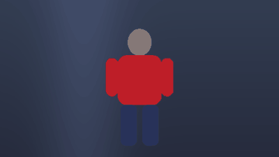
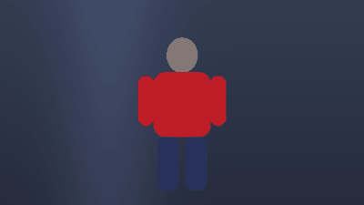
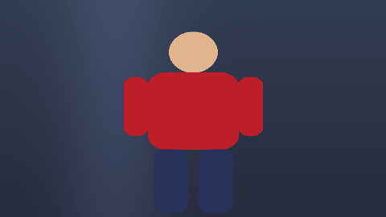
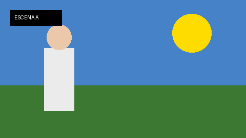

# obs-retro-tv

*Retro TV effects for OBS: time tunnel, and more to come.*

Shaders para **OBS Studio** inspirados en los efectos de las series de televisión de los 60: túneles del tiempo, cambios de escena con emblemas giratorios, pasillos de puertas…

*[English below](#english)*

Las animaciones de este README son simulaciones aproximadas de los shaders con una figura de ejemplo; en OBS el grano y algunos detalles varían. / The animations are approximate simulations of the shaders.

## Requisitos

- OBS Studio
- Plugin [obs-shaderfilter](https://github.com/exeldro/obs-shaderfilter)

## Shaders

| Archivo | Qué hace |
|---|---|
| `tunel.shader` | Túnel del tiempo: anillos que se hunden sin fin hacia un punto de fuga y la fuente cae girando y encogiéndose hacia el fondo, o llega desde él. Con grano y parpadeo de película. |
| `dimension.shader` | La fuente pierde el color y flota en un vacío en blanco y negro con estrellas y una espiral hipnótica; se aleja dando tumbos en 3D y se rompe como un vidrio. Al revés sirve como entrada. |
| `teletransportador.shader` | La fuente se llena de destellos que titilan, se ilumina con el color del rayo y se disuelve en franjas verticales hasta que solo quedan las chispas con su silueta. Al revés sirve como entrada. |
| `emblema.shader` | **Transición** tipo stinger: la escena se acerca y gira cada vez más rápido con desenfoque circular, cambia a la escena nueva en pleno giro y frena; una silueta (murciélago, estrella o tu PNG) se acerca a la cámara sin girar. |

## Instalación

1. Descarga los archivos `.shader` (o clona el repo).
2. En OBS, clic derecho sobre la fuente o escena → **Filtros** → **+** → **User-defined shader**.
3. Activa **Load shader text from file** y elige el archivo `.shader`.
4. Ajusta los parámetros.

## Túnel del tiempo (`tunel.shader`)

Aplícalo a la fuente que debe caer al túnel. Se ve mejor si la fuente tiene **transparencia** (cámara con quitado de fondo, chroma key o un PNG): el túnel aparece detrás de la figura. Sin transparencia cae el rectángulo completo, como un recorte.

| Progreso | Caer al túnel | Salir del túnel |
|---|---|---|
| 0–10 % | El túnel aparece detrás de la fuente | Solo el túnel |
| 10–88 % | La fuente gira y se encoge hacia el centro | La fuente llega girando desde el fondo |
| 88–100 % | Solo el túnel | El túnel se desvanece y queda la fuente tal cual |

| Parámetro | Efecto |
|---|---|
| Reproducir en bucle | Repite la secuencia sola. Apágalo para controlar el Progreso a mano o con el script |
| Duración | Segundos que dura la secuencia completa |
| Salir del túnel | Invierte la secuencia: sirve como entrada en vez de salida |
| Centro del túnel X/Y | Dónde queda el punto de fuga |
| Bamboleo del túnel | Qué tanto se mueve el punto de fuga en una órbita lenta |
| Densidad de anillos / Espiral | Cuántos anillos se ven y si forman brazos de espiral (0 = anillos concéntricos) |
| Velocidad del túnel | Qué tan rápido avanzan los anillos hacia el fondo (negativo = hacia afuera) |
| Contraste de los anillos / Pulsación de luz | Bordes suaves o duros, y ondas de brillo que viajan por el túnel |
| Color del túnel | Blanco = blanco y negro; cualquier otro color lo tiñe |
| Vueltas / Vaivén del viajero | Cuántas vueltas da la fuente al caer y cuánto se balancea |
| Grano / Parpadeo | Aspecto de película de los 60 |

## Dimensión (`dimension.shader`)

Aplícalo a la fuente que debe irse a la otra dimensión. Igual que el túnel, se ve mejor con **transparencia**; sin ella se va el rectángulo completo, como una ventana flotando.

| Progreso | Normal | Aparecer desde la dimensión |
|---|---|---|
| 0–15 % | Aparece el vacío detrás y la fuente pierde el color | Solo el vacío |
| 10–75 % | Se aleja hacia el punto de fuga, girando y ladeándose en 3D | Los pedazos se juntan… |
| 50–85 % | Se rompe en pedazos que se separan, giran y se apagan | …y llega flotando desde el fondo |
| 85–100 % | Solo el vacío | El vacío se desvanece y la fuente recupera el color |

| Parámetro | Efecto |
|---|---|
| Aparecer desde la dimensión | Invierte la secuencia: sirve como entrada |
| Punto de fuga X/Y / Qué tan lejos se va | Hacia dónde y qué tan lejos flota |
| Giro / Ladeo en 3D | Vueltas sobre sí misma y cuánto se inclina en perspectiva |
| Romperse como vidrio / Tamaño de los pedazos | Si se rompe al final o solo se desvanece |
| Blanco y negro / Tono | Qué tanto pierde el color y el tono del blanco y negro |
| Espiral del fondo / Brazos / Velocidad | La espiral hipnótica del vacío (0 = solo estrellas) |
| Densidad de estrellas / Grano / Parpadeo | Aspecto de película de los 60 |

Funciona con `retro-control.lua` igual que el túnel.

## Teletransportador (`teletransportador.shader`)

Aplícalo a la fuente que se va a teletransportar. Necesita **transparencia** (cámara con quitado de fondo, chroma key o PNG), porque las chispas siguen la silueta.

| Progreso | Desmaterializar | Materializar |
|---|---|---|
| 0–15 % | Aparecen los destellos sobre la figura | Nada |
| 10–40 % | La figura se ilumina con el color del rayo y brilla alrededor | Las chispas llegan con la forma de la figura… |
| 30–70 % | Se disuelve en franjas verticales y las chispas se intensifican | …y la figura se forma franja por franja |
| 70–100 % | Las chispas se apagan | El brillo se apaga y queda la fuente tal cual |

| Parámetro | Efecto |
|---|---|
| Materializar | Invierte la secuencia: sirve como entrada |
| Color del rayo / de las chispas | Dorado por defecto; azul o blanco para otros estilos |
| Cantidad / Tamaño de las chispas | Cuántos destellos hay y qué tan grandes son |
| Las chispas suben / Velocidad del titileo | Hacia dónde se mueven (negativo = bajan) y qué tan rápido titilan |
| Brillo alrededor / Ancho del brillo | El resplandor de la figura mientras se carga de energía |
| Ancho de las franjas / Ondulación | Cómo se disuelve y cuánto tiembla la figura |

También funciona con `retro-control.lua`.

## Disparar el efecto con un hotkey (script)

Por sí solo, el shader solo puede correr en bucle porque no sabe cuándo "empieza" el efecto. `retro-control.lua` apaga el bucle y mueve el Progreso de 0 a 100 en la duración del filtro.

1. **Herramientas → Scripts → +** y elige `retro-control.lua`.
2. En **Filtro** elige tu filtro de túnel (si no aparece, **Actualizar lista**).
3. Presiona **Reproducir**, o asigna un atajo en **Configuración → Atajos de teclado → Reproducir efecto (obs-retro-tv)**.

## Emblema giratorio (`emblema.shader`)

Este es una **transición**, no un filtro: se dispara sola al cambiar de escena, como un stinger, pero gira la imagen real de tus dos escenas.

1. En el panel **Transiciones de escena** → **+** → **User-defined shader**.
2. Activa **Load shader text from file** y elige `emblema.shader`.
3. Pon una duración de 1–2 s.

| Tiempo | Escena | Silueta |
|---|---|---|
| 0–10 % | La escena actual se acerca hasta que su alto cubre la diagonal de la pantalla: puede girar sin que se vean bordes negros | Aparece a su tamaño inicial |
| 10–50 % | Gira cada vez más rápido; el desenfoque circular crece con la velocidad | Se acerca; a la mitad ocupa todo el alto |
| 47–53 % | En el giro más rápido cambia a la escena nueva, que ya viene girando y desenfocada | |
| 50–90 % | La escena nueva frena y se va enfocando | Regresa a su tamaño inicial |
| 90–100 % | Ya quieta y nítida, vuelve a su tamaño normal | Se desvanece |

La silueta nunca gira.

| Parámetro | Efecto |
|---|---|
| Silueta | Murciélago, estrella o imagen (PNG) |
| Imagen de la silueta | Solo se usa con *Silueta = Imagen*. Usa un PNG **cuadrado con transparencia**; su alto es el tamaño de la silueta |
| Color de la silueta | Color del murciélago o la estrella (negro por defecto). Su transparencia también afecta al PNG |
| Tamaño inicial y final / a media transición | Alto de la silueta en % de la pantalla al empezar y terminar, y en el punto más cercano (100 = todo el alto) |
| Vueltas de la escena | Cuántas vueltas da la escena (negativo = al revés). Siempre son vueltas completas, así la escena nueva llega derecha |
| Desenfoque circular máximo | Qué tanto se barre la imagen en el giro más rápido (0 = sin desenfoque) |
| Duración del acercamiento | Qué parte del tiempo dura el acercamiento inicial y el regreso al tamaño normal |
| Puntas / Picos de la estrella | Forma de la estrella |

Para regresar a los valores estándar, carga `retro-control.lua` (**Herramientas → Scripts**) y presiona **Restablecer valores estándar del emblema**. No uses el botón *Predeterminados* de las propiedades de la transición: también borra el archivo del shader.

No incluye ningún logotipo: si usas uno, asegúrate de tener derecho a usarlo.

No está afiliado ni respaldado por ninguna serie, estudio o franquicia.

---

## English

Shaders for **OBS Studio** inspired by 1960s TV effects: time tunnels, spinning-emblem scene changes, corridors of doors…

### Requirements

- OBS Studio
- [obs-shaderfilter](https://github.com/exeldro/obs-shaderfilter) plugin

### Shaders

English versions, with English labels and comments, are in the [`en/`](en) folder:

| File | What it does |
|---|---|
| `en/time-tunnel.shader` | Time tunnel: rings sinking endlessly toward a vanishing point while your source tumbles, spinning and shrinking, into it (or out of it, with *Exit the tunnel*). Film grain and flicker included. |
| `en/dimension.shader` | Your source loses its color and floats in a black-and-white void with stars and a hypnotic spiral, tumbles away in 3D and shatters like glass. Reverse it (*Appear from the dimension*) for an entrance. Works with `retro-control.lua`. |
| `en/teleporter.shader` | Your source fills with twinkling sparkles, glows in the beam color and dissolves in vertical stripes until only the sparkles remain in its shape. Reverse it (*Materialize*) for an entrance. Needs a source with transparency. Works with `retro-control.lua`. |
| `en/emblem.shader` | Stinger-style scene **transition**: the scene zooms in and spins faster and faster with radial motion blur, cuts to the next scene at full speed and slows down, while a non-spinning silhouette (bat, star or your own square PNG) rushes toward the camera. |

The Spanish originals (`tunel`, `dimension`, `teletransportador`, `emblema`) are in the root; the code is the same.

Add the filter with **User-defined shader → Load shader text from file**. The effect looks best on a source with transparency (background removal, chroma key or PNG).

`emblem.shader` is a transition: add it under **Scene Transitions → + → User-defined shader**, load the file and set 1–2 s. No logos are included; only use one you have the rights to.

To play the tunnel, dimension or teleporter once with a hotkey, load `en/retro-control.lua` (**Tools → Scripts**), pick the filter and press *Play*, or bind *Play effect (obs-retro-tv)* under **Settings → Hotkeys**. The script also has a button to restore the emblem transition to its standard values.

Not affiliated with or endorsed by any series, studio or franchise.

## License

MIT
